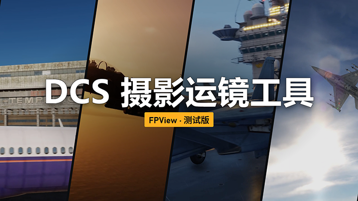

# DCS FPView

**DCS World 穿越机 / 航拍机自由摄影工具（免费软件）**
**FPV / camera-drone free camera tool for DCS World (freeware)**

作者 / Author：**☆Hibiki☆** · bilibili [HBK_3546](https://space.bilibili.com/588653526)（UID 588653526）· 邮箱 / E-mail：hibikih33@gmail.com

> **THIS MATERIAL IS NOT MADE OR SUPPORTED BY EAGLE DYNAMICS SA.**
> 本软件并非由 Eagle Dynamics SA 制作或支持。

[**下载最新版 / Download the latest release**](../../releases/latest) · 中文 / English 界面

---

## 中文

### 这是什么

用摇杆或键盘，把 DCS 的摄影机当成一架穿越机或航拍机来飞，用来拍摄、录像和娱乐飞行。

- **穿越机模式**：横滚、俯仰、偏航控制姿态，油门直接控制推力，像真实穿越机一样手动飞行；可保存两套轴设置（预设 1 / 预设 2）。
- **航拍机模式**：推杆平移、松杆刹停、油门回中保持高度，可额外绑定云台轴。
- **两种起飞方式**：F11 从当前视角位置自由起飞；F4 跟随选中的单位，在它周围飞行。
- **飞行控制**：Acro 手动（默认）、自稳、定点悬停。
- **只有一个快捷键**：默认 Ctrl+Alt+F6 接管 / 释放，可自定义；只在 DCS 窗口处于前台时生效。
- **首次启动向导**：一步步完成接入 DCS、选择模式、绑定摇杆和试飞。

### 使用方法

1. 从 [Releases](../../releases/latest) 下载 `DCS-FPView-0.9.15-EA-windows.zip`，**把整个压缩包解压**到一个可写的位置（不要在压缩软件里直接双击 EXE）。
2. **关闭 DCS**，运行 `DCS-FPView.exe`，按首次向导安装 DCS 接入脚本（也可运行 `Install.cmd`），选择 `Saved Games` 下的 DCS 配置目录。不需要另外安装 Python。
3. 进入任意单机或多人任务，按 F11（自由起飞）或 F4（跟随单位），在 DCS 窗口中按 **Ctrl+Alt+F6** 接管；再按一次释放。切换窗口、连接中断或设备断开也会自动释放。
4. **卸载**：关闭 DCS，在程序内卸载接入脚本或运行 `Uninstall.cmd`，再删除程序文件夹。`Export.lua` 会恢复为安装前的原样。

### 安全与隐私

- 只通过 DCS World 自带的 Export / GUI 脚本接口工作，不修改游戏安装目录；安装时自动备份原 `Export.lua`，可随时卸载。
- 只使用本机回环通信（127.0.0.1），**不联网、不收集任何数据**。程序每次启动生成随机会话口令，只与 DCS 进程通信。
- 接管期间会临时截获所有摇杆设备的轴输入（防止摇杆同时控制飞机），释放后立即恢复。
- 程序自己的设置、日志和备份保存在 EXE 旁边；在 DCS 配置目录（`Saved Games\DCS…`）中只写入接入脚本（`Scripts\DCS_FPView`、`Scripts\Hooks` 和 `Export.lua` 中带标记的一段）、会话口令文件和 `Logs\DCS_FPView.log`。

### 常见问题

- **蓝色的「Windows 已保护你的电脑」**：这是 Windows 对所有新发布、未签名程序的统一提示（SmartScreen），不是检测到病毒。点「更多信息」→「仍要运行」即可，只需一次。
- **杀毒软件报毒**：VirusTotal 3/70。程序用 PyInstaller 打包、没有代码签名，少数杀毒引擎会对这类程序做启发式误报；用同一工具打包、只弹出一个对话框的空程序同样会被报毒。
- **校验文件**：下载后可在 PowerShell 运行 `Get-FileHash .\DCS-FPView-0.9.15-EA-windows.zip`，结果应为
  `B523762ACDCBC28472B8D2AA3F17F13F124125E7E6A25347D9D796CDCCABB187`
- **升级旧版本**：先用旧版卸载接入脚本并退出，再解压新版并重新安装接入脚本。

### 使用说明

- 本软件用于摄影、录像与娱乐飞行，单人和多人游戏均可使用。作者不支持、并明确反对任何在 PvP 对抗中利用本软件获取不公平优势的作弊行为；在多人服务器中请遵守服务器规则，由此产生的一切后果由使用者自行承担。
- 使用本软件录制或制作的图片、视频等内容归使用者所有，可自由发布，包括带收益的平台。
- 免费软件，保留所有权利，使用条款见 [LICENSE](LICENSE)。未经作者许可请勿转载、修改或用于盈利；分享请附本页链接。
- 压缩包内含开源运行库（Python、Tcl/Tk、OpenSSL、zlib 等），依据其许可证随程序免费分发，许可证文本见压缩包内 `licenses` 文件夹与 `THIRD_PARTY_NOTICES.md`。不含任何 DCS 游戏文件或游戏素材。
- 当前为 EA（抢先体验）版本，欢迎在 [Issues](../../issues) 反馈问题。

---

## English

### What it is

Fly the DCS camera like an FPV quad or a camera drone with your stick or keyboard, for filming, recording and fun flying.

- **FPV mode**: roll, pitch and yaw control the attitude and the throttle drives thrust directly, flown by hand like a real FPV quad; two axis presets (preset 1 / preset 2).
- **Camera-drone mode**: the stick moves the drone and centring it brakes; a centred throttle holds altitude; an optional gimbal axis.
- **Two ways to launch**: F11 takes off from the current view; F4 follows the selected unit and flies around it.
- **Flight modes**: Acro (default), self-level, position hold.
- **A single hotkey**: Ctrl+Alt+F6 by default takes over / releases the camera and can be changed; it works only while the DCS window is in front.
- **First-run guide**: connects DCS, picks the mode, binds the stick and walks you through a first flight.

### How to use

1. Download `DCS-FPView-0.9.15-EA-windows.zip` from [Releases](../../releases/latest) and **extract the whole archive** to a writable folder (do not launch the EXE from inside the archive viewer).
2. **With DCS closed**, run `DCS-FPView.exe` and install the DCS bridge from the first-run guide (or run `Install.cmd`), selecting your DCS profile under `Saved Games`. No separate Python install is needed.
3. Enter any single-player or multiplayer mission, press F11 (free launch) or F4 (follow a unit), then press **Ctrl+Alt+F6** in the DCS window to take over; press it again to release. Switching windows, losing the connection or unplugging a device also releases the camera.
4. **Uninstall**: close DCS, remove the bridge in the app or run `Uninstall.cmd`, then delete the program folder. `Export.lua` is restored to its pre-install state.

### Safety and privacy

- Works only through DCS World's own Export / GUI script interfaces and never touches the game installation; `Export.lua` is backed up on install and the bridge can be removed at any time.
- Local loopback communication only (127.0.0.1): **no internet access, no data collection**. A random session key is generated at every start and only DCS processes are talked to.
- While the camera is taken over, axis input from all joystick devices is held temporarily (so the stick does not also fly your aircraft) and released immediately afterwards.
- The program's own settings, logs and backups are stored next to the EXE; in the DCS profile (`Saved Games\DCS…`) it writes only the bridge scripts (`Scripts\DCS_FPView`, `Scripts\Hooks` and one marked block in `Export.lua`), a session key file and `Logs\DCS_FPView.log`.

### FAQ

- **Blue "Windows protected your PC" screen**: Windows SmartScreen shows this for every new, unsigned program; it is not a virus detection. Click "More info" → "Run anyway"; you only need to do this once.
- **Antivirus warnings**: VirusTotal 3/70. The program is packaged with PyInstaller and is not code-signed, and a few antivirus engines flag such programs heuristically; an empty program built with the same tool, which only shows one dialog box, is flagged as well.
- **Verify your download**: run `Get-FileHash .\DCS-FPView-0.9.15-EA-windows.zip` in PowerShell; it should print
  `B523762ACDCBC28472B8D2AA3F17F13F124125E7E6A25347D9D796CDCCABB187`
- **Upgrading**: remove the bridge with the old version and close it, then extract the new version and install the bridge again.

### Terms

- This software is meant for camera work, video recording and fun flying, in single-player and multiplayer alike. The author does not support and explicitly opposes any use of it to cheat or gain an unfair advantage in PvP; on multiplayer servers, follow the server's rules. Users bear full responsibility for any consequences of their use.
- Images and videos you record with this software belong to you and may be published freely, including on monetized platforms.
- Freeware, all rights reserved; see [LICENSE](LICENSE). Please do not re-upload, modify or sell it without the author's permission; share this page's link instead.
- The archive bundles open-source runtimes (Python, Tcl/Tk, OpenSSL, zlib and others) whose licences permit free redistribution with the program; the licence texts are in the archive's `licenses` folder and `THIRD_PARTY_NOTICES.md`. No DCS game files or assets are included.
- This is an Early Access (EA) version; please report problems in [Issues](../../issues).
